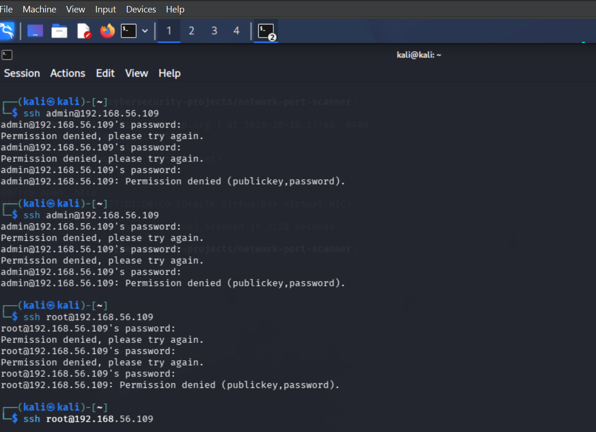
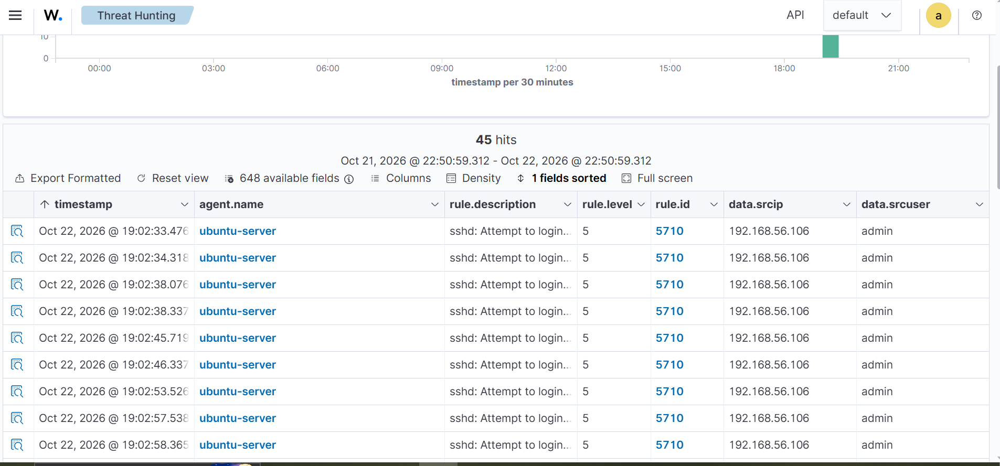

# IR-001: SSH Brute-Force Attempt Against ubuntu-server


| Field | Detail |
|---|---|
| **Date / time** | Oct 22, 2026, 18:02 to 18:07 UTC (about 5 minutes) |
| **Affected host** | ubuntu-server (hostname `ubuntuserver`), 192.168.56.109, Wazuh agent 001 |
| **Source IP** | 192.168.56.106 (internal lab host, Kali VM) |
| **Accounts targeted** | `admin`, `root`, `test`, `oracle` (**`root` is the only real account**) |
| **Connections / attempts** | 8 SSH connections, 24 failed passwords (3 per connection) |
| **Detections** | 5710, 5712 (non-existent users); 5760, 5763, 5503, 5551, 2502 (`root`) |
| **MITRE ATT&CK** | T1110.001 Brute Force: Password Guessing (Credential Access) |
| **Severity** | Low (no successful login; `root` password login disabled; internal source) |
| **Verdict** | **True positive detection; benign authorized security test** |

## Summary
One internal host opened 8 SSH connections to ubuntu-server and made 24 failed password attempts against four accounts, two connections per account. Wazuh detected all four accounts, including level-10 correlation alerts. No login succeeded.

## Timeline (UTC)

| Account | Exists? | Window | Correlation alert |
|---|---|---|---|
| admin | No | 18:02:33 to 18:03:18 | Rule 5712 at 18:02:54 |
| **root** | **Yes** | 18:04:04 to 18:04:20 and 18:04:51 to 18:05:01 | Rules 5763 / 5551 / 2502 (level 10) |
| test | No | 18:05:39 to 18:06:29 | Rule 5712 at 18:05:57 |
| oracle | No | 18:06:57 to 18:07:47 | Rule 5712 at 18:07:21 |

*admin/test/oracle windows are Wazuh alert times converted from dashboard time (UTC+1) to UTC. The `root` windows come from the server log.*

## Analysis

**Pattern:** Attempts went through one account at a time, 6 failed passwords each over 2 connections. This is brute force (T1110.001), not password spraying (T1110.003), which would rotate accounts with few tries each.

**Rate:** 24 attempts in about 5 minutes. The activity is consistent with scripted or rapid manual attempts.

**The one real account:** Attempts against `root` matter most because they could possibly succeed. But They did not:
- No `Accepted` line in the server log for 18:00 to 18:10 UTC.
- `sshd -T` shows `permitrootlogin without-password`: password login for root is disabled, so password guesses could not succeed.

**Reconciling the counts.** Three different numbers describe this attack:

| Measure | Value | What it counts |
|---|---|---|
| SSH connections | 8 | Distinct sshd processes (PIDs 63515 to 63541) |
| Failed passwords | 24 | `Failed password` log lines (3 per connection) |
| Rule 5710 alerts | 45 | Non-existent-user alerts |

For the three non-existent accounts, the server logged 24 relevant lines (6 `Invalid user` lines, one per connection, plus 18 `Failed password` lines). Each line was ingested twice (see FINDING-001), giving 48. Wazuh raised 45 alerts of rule 5710 plus 3 of rule 5712, which equals 48. This reading is consistent with the data; the duplication itself was confirmed on separate test runs (see FINDING-001).

**Detection coverage.** `root` attempts raised levels 5 and 10 (rules 5760, 5503 at level 5; 5763, 5551, 2502 at level 10). Monitoring covered the account that mattered. The field holding the targeted account differs: `data.srcuser` for non-existent users, `data.dstuser` for existing users.

## Evidence

```
Oct 22 18:07:46 ubuntuserver sshd[63541]: Failed password for invalid user oracle from 192.168.56.106 port 44786 ssh2
Oct 22 18:04:04 ubuntuserver sshd[63529]: Failed password for root from 192.168.56.106 port 36500 ssh2
Oct 22 18:04:49 ubuntuserver sshd[63531]: pam_unix(sshd:auth): authentication failure; ... rhost=192.168.56.106 user=root
```
```
$ sudo journalctl -u ssh --since "2026-10-22 18:00" --until "2026-10-22 18:10" | grep -i "accepted"
(no output)
$ sudo sshd -T | grep -i permitrootlogin
permitrootlogin without-password
```
# LAUNCHING OF ATTACK FROM KALI

 

# WAZUH DETECTION

 

## Recommended actions (if this were a real external attacker)

**Immediately**
1. Block the source IP at the firewall.
2. Check all hosts for successful logins (rule 5715 / "Accepted") from that IP over the last 24 hours.
3. Review `root` activity and any key-based logins in the window.

**Preventive measure**
1. Keep root password login disabled; disable SSH password authentication for all accounts and use keys.
2. Install fail2ban; restrict port 22 to known management IPs (`ufw`).

**Escalation**

In production, escalate to the server owner if the source is external or any login succeeded.

## Lessons learned
1. **Search by source, not by rule.** Filtering on rule 5710 hid the `root` attempts; searching the source IP and `full_log` exposed them.
2. **An empty search is not proof of absence.** `data.srcuser: root` returned nothing because the field was `data.dstuser`.
3. **A count means nothing without knowing what it counts.** 45 alerts, 24 attempts, and 8 connections all describe the same attack.
4. **Verify inferences.** My first estimate of the connection count was wrong until checked against `journalctl`.
5. **Confirm time zones.** Server logs are UTC; the dashboard displayed UTC+1.
