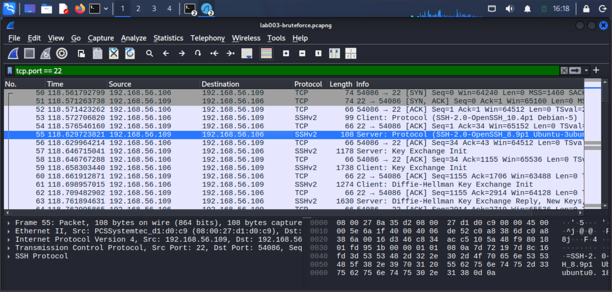
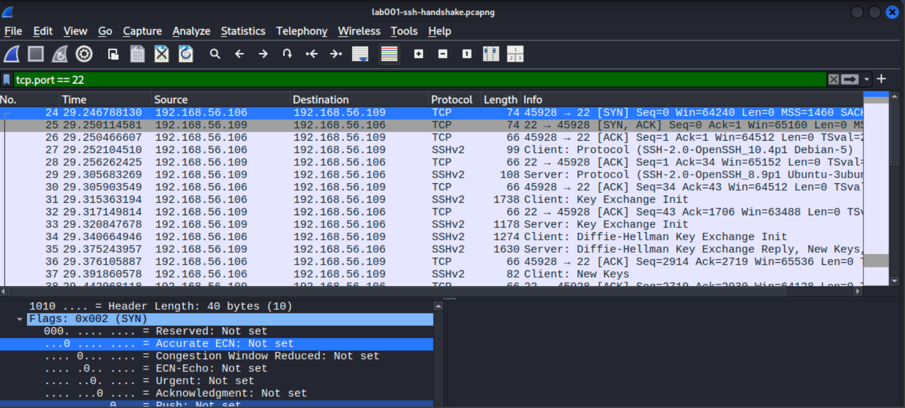
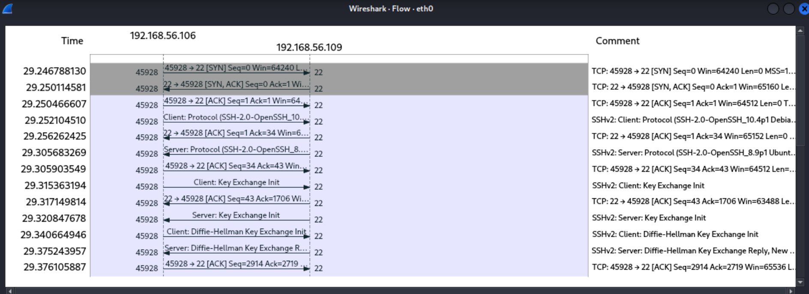
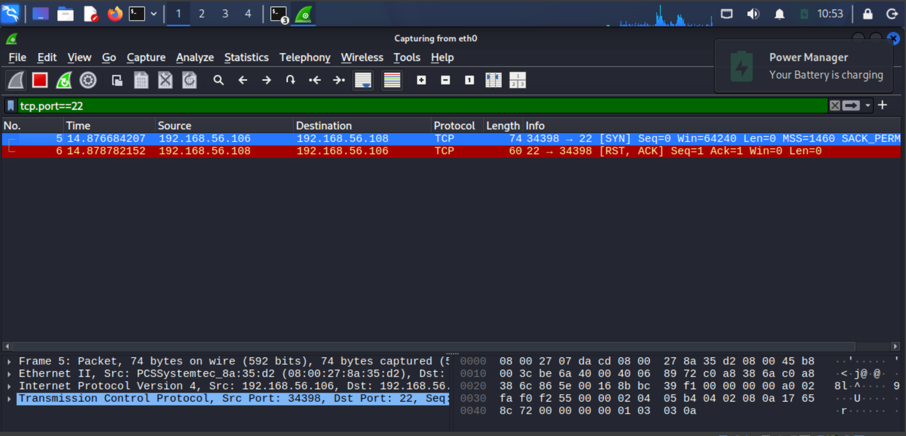

# LAB-001: Packet-Level Analysis of SSH Connections

## Objective
Capture and analyse SSH traffic between two lab hosts in order to 

(1) identify the TCP handshake, open-port, and closed-port patterns 

(2) see what a brute-force attempt looks like on the wire 

(3) correlate packet evidence with server logs and SIEM alerts.

## Environment

| Item | Detail |
|---|---|
| Capture host | Kali Linux VM, 192.168.56.106, interface `eth0` (host-only network) |
| Target | ubuntu-server, 192.168.56.109 (OpenSSH, Wazuh agent 001) |
| Closed-port target | Wazuh server, 192.168.56.108 (no SSH service) |
| Tools | Wireshark 4.6.6, `journalctl`, Wazuh dashboard |
| Display filters | `tcp.port == 22`; `tcp.flags.syn == 1 && tcp.flags.ack == 0` |

All traffic was generated inside an isolated lab.

## Findings

### 1. Open port: TCP three-way handshake (Lab 2.1)
Command: `ssh admin@192.168.56.109`, one wrong password, then Ctrl+C.

| Packet | Direction | Flags | Meaning |
|---|---|---|---|
| 24 | 192.168.56.106:45928 → 192.168.56.109:22 | SYN | Client requests a connection |
| 25 | 192.168.56.109:22 → 192.168.56.106:45928 | SYN, ACK | Server accepts |
| 26 | 192.168.56.106:45928 → 192.168.56.109:22 | ACK | Connection established |

- The SYN-ACK arrived about 3 ms after the SYN.
- Wireshark shows relative sequence numbers by default (Seq=0 in packet 24).
- The SYN flag value is `0x002` in packet 24 and `0x012` (SYN + ACK) in packet 25.

**After the handshake** the capture shows SSH negotiating in order:
1. Both sides send plain-text version banners (packets 27 and 29).
2. Key Exchange Init, then Diffie-Hellman Key Exchange Init and Reply (packets 31 to 35).
3. `New Keys` (packet 37): encryption starts.
4. `Encrypted packet` (packet 39): the login exchange is no longer readable.

The connection closed gracefully: a `FIN, ACK` exchange followed by a final `ACK`.

# PACKETS LIST WITH THE HANDSHAKE:

  

# EXPANDED TCP FLAGS OF PACKET 24:

 

# FLOW GRAPH:
 
 

### 2. Closed port: connection refused (Lab 2.2)
Command: `ssh admin@192.168.56.108`, where nothing listens on port 22.

| Packet | Direction | Flags | Meaning |
|---|---|---|---|
| 30 | 192.168.56.106:44594 → 192.168.56.108:22 | SYN | Client asks to open a connection |
| 31 | 192.168.56.108:22 → 192.168.56.106:44594 | **RST, ACK** | Host refuses |

- Only **2 packets**, and no handshake: the host answered the SYN with `[RST, ACK]` (`Seq=1 Ack=1 Win=0 Len=0`).
- ACK acknowledges the SYN; RST tells the client to abandon the connection.
- The reply arrived in under 1 ms (68.813855 s to 68.814744 s), because the host was up and answered immediately.
- The terminal reported `Connection refused`: the same event seen from the user's side.
- The host is reachable, but no service is listening.

# CONNECTION REFUSE PACKET LIST:

 

### 3. Brute-force pattern on the wire (Lab 2.3)
Two `ssh test@192.168.56.109` sessions, each with 3 wrong passwords.

| Measure | Result |
|---|---|
| Total packets captured | 186 |
| SYN packets (filter `tcp.flags.syn == 1 && tcp.flags.ack == 0`) | **2** |
| TCP conversations | 2 (source ports **59114** and **54086**) |
| Password attempts | 6 (3 per connection) |

- Each `ssh` command produced **one connection**, and all three password tries happened **inside the same encrypted session**.
- No username or password was visible in any packet, because SSH encrypts everything after `New Keys`.

### 4. Correlation: packets, server log, and SIEM (Lab 2.4)

| Wireshark source port | Server log (agent clock, Oct 29) | PID | Wazuh alerts | Rule 5712 |
|---|---|---|---|---|
| 54086 | 01:58:07 to 01:58:51 | 6131 | 8 | Fired on the 8th event |
| 59114 | 02:00:48 to 02:01:06 | 6134 | 8 | Fired on the 8th event |

Each connection produced 4 alerting log lines (`Invalid user` plus 3 `Failed password`) and a final `Connection closed by invalid user test ... [preauth]` line, which is the server's record of the teardown. "Preauth" means the connection ended before any authentication succeeded. Each log line produced two Wazuh alerts because of duplicate log ingestion that existed at the time (see FINDING-001); the fix was applied later. In total the two connections produced 16 alerts from 8 log lines, split exactly 8 from `journald` and 8 from `/var/log/auth.log`.

## Comparison of packet patterns

| Situation | Packets seen | SSH client message | Meaning |
|---|---|---|---|
| Open port | SYN → SYN-ACK → ACK, then SSH | none | Service listening |
| Closed port | SYN → RST, ACK | Connection refused | Host up, nothing listening |
| Brute force (this lab) | Repeated complete connections to one port | Permission denied | Many sessions to one service |
| Filtered port / port scan | *Not captured in this lab* | Timeout | Expected: silence, or SYNs to many ports |

## Link to IR-001
The packet evidence adds three points to the SIEM view. 

First, it shows the activity as separate connections (one handshake per `ssh` command), which explains why alert counts exceed attempt counts. 

Second, it independently confirms the source host and port. 

Third, it shows the limit of network visibility: the SIEM could name the usernames only because it read host logs, since the packets are encrypted.

## Additional observations
1. **Banner exposure:** the server's plain-text banner discloses its software and version (`SSH-2.0-OpenSSH_8.9p1 Ubuntu-3ubuntu0.18`), which scanners use for reconnaissance.
2. **Clocks disagreed across systems:** on Oct 29 the Wazuh timestamps were about 18 hours 3 minutes later than the server's log times (after accounting for the UTC+1 dashboard display). The cause is analysed in FINDING-002. Evidence was therefore correlated by **source port and PID**, not by time.
3. **Duplicate alerts:** 8 log lines produced 16 alerts in this capture window (see FINDING-001).

## Lessons learned
1. Match packet evidence to logs by connection identifiers (source port, PID), not only by timestamp.
2. Encryption limits packet analysis to metadata: who, when, how often, and how much.
3. An RST means the host is reachable but the port is closed; silence suggests filtering or a host that is down.
4. Counting what happens on the network (connections) and what the SIEM reports (alerts) gives different numbers, and both are needed.
5. Check clock synchronization before building any multi-system timeline.
